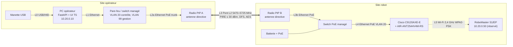

# ARCHITECTURE — RoboMaster Long Range Control System

> **Statut : proposition (étapes 1–2), non testée.** Aucun élément de ce schéma n'a été
> installé ni mesuré. Les choix dépendent des conclusions de `AUDIT.md`, notamment de la
> décision sur l'interface robot (options A/B/C, §10 de l'audit).

## 1. Vue d'ensemble

```
=========================== SITE OPÉRATEUR (A + B) ===========================

  [Manette USB] --L0--> [PC opérateur : backend FastAPI + UI TypeScript]
                         10.20.0.10 (VLAN 20) / 10.99.0.10 (VLAN 99)
                                      |
                                      L1  Ethernet
                                      |
                        [Pare-feu / switch managé]  -- WAN optionnel :
                         VLAN 20 contrôle               AUCUN flux entrant
                         VLAN 99 gestion
                                      |
                                      L2a Ethernet PoE (trunk) + parafoudre
                                      |
                        [Radio PtP A + antenne directive]  (mât, extérieur)

                                      ^
                                      |   L3  pont transparent couche 2
                                      |   5470–5725 MHz, PIRE <= 1 W (TPC), DFS
                                      |   chiffré, visibilité directe + Fresnel 60 %
                                      |   distance : À MESURER (aucune garantie)
                                      v

============================ SITE ROBOT (D + E) ==============================

                        [Radio PtP B + antenne directive]  (mât, extérieur)
                                      |
                                      L3b Ethernet PoE + parafoudre
                                      |
          [Batterie + PoE] ---- [Switch PoE managé]
                                      |
                                      L4  Ethernet PoE (VLAN 20)
                                      |
                        [Cisco C9120AXE-E + AIR-ANT2544V4M-RS (omni 4 dBi)]
                                      :
                                      L5  Wi-Fi 2,4 GHz, SSID dédié WPA2-PSK
                                      :   (zone d'évolution : quelques dizaines
                                      :    de mètres, à mesurer)
                        [RoboMaster S1 / EP]  10.20.0.50 (réservation DHCP)
```

Diagramme équivalent (Mermaid) :



## 2. Description de chaque liaison

| Id | De → Vers | Support | Rôle | Exigences | Statut |
|---|---|---|---|---|---|
| L0 | Manette → PC | USB / HID (Gamepad API navigateur) | Consignes opérateur | Lecture locale, jamais transmise brute : le backend applique limites + homme-mort | ❓ à développer |
| L1 | PC → pare-feu/switch | Ethernet 1 Gbit/s | Accès au réseau de contrôle | IP fixe ; le backend n'écoute que sur l'interface de contrôle et `localhost` | ❓ |
| L2a | Switch → Radio A | Ethernet PoE, câble extérieur blindé, parafoudre | Alimentation + données radio | Trunk VLAN 20 (contrôle) + VLAN 99 (gestion radios) ; PoE selon radio | ❓ |
| L3 | Radio A ↔ Radio B | Radio 5 GHz PtP, antennes directives | Transport IP bidirectionnel transparent | Pont **couche 2** ; MTU ≥ 1500 ; chiffrement ; PIRE ≤ 30 dBm (TPC) ; DFS ; ≥ 30 Mbit/s agrégés visés | ❓ matériel à choisir |
| L3b | Radio B → switch robot | Ethernet PoE | Idem L2a côté robot | Idem L2a | ❓ |
| L4 | Switch → C9120AXE-E | Ethernet PoE | Alimentation + uplink AP | Port accès VLAN 20 (ou trunk si EWC/gestion) ; PoE 802.3at | ❓ |
| L5 | C9120 → robot | Wi-Fi 2,4 GHz (5 GHz à tester) | Réseau local du robot | SSID dédié **WPA2-PSK**, pas d'isolation client, pas de portail ; IP robot réservée ; puissance ≤ 100 mW PIRE | ✅ mode routeur officiel / ❓ test matériel |

## 3. Plan d'adressage proposé

| VLAN | Réseau | Usage | Équipements |
|---|---|---|---|
| 20 | `10.20.0.0/24` | Contrôle robot (vidéo + commandes) | PC `.10`, robot `.50` (réservation DHCP), DHCP sur le pare-feu |
| 99 | `10.99.0.0/24` | Gestion des équipements | Radio A `.2`, Radio B `.3`, switch robot `.4`, AP/EWC `.5`, PC (interface de gestion) `.10` |

- Pas de passerelle Internet pour le VLAN 20 (le robot n'a pas besoin d'Internet pour le SDK ;
  ❓ l'app DJI peut en avoir besoin pour certaines fonctions — à vérifier).
- Les interfaces de gestion (HTTPS/SSH/SNMPv3) ne sont accessibles que depuis le VLAN 99.
- Le Network Monitor sondera : PC → radio A, radio B, switch, AP, robot (ICMP + TCP) ;
  et lira les compteurs radio via SNMPv3 si les radios le permettent.

## 4. Flux réseau attendus (SDK EP — cf. AUDIT §2.1)

| Flux | Sens | Port | Priorité QoS proposée |
|---|---|---|---|
| Commandes | PC → robot | TCP 40923 (Plaintext) ou 20020 (SDK binaire) | Haute (DSCP EF/CS6) |
| Télémétrie | robot → PC | UDP 40924 / 40925 | Haute |
| Vidéo | robot → PC | TCP 40921 | Moyenne (AF41) |
| Découverte | robot → broadcast | UDP 40926/40927 | Inutile si IP fixe |
| Sondes supervision | PC → équipements | ICMP, SNMPv3 (UDP 161) | Basse |

## 5. Architecture logicielle (aperçu — étape 3)

```
┌──────────────── Navigateur (TypeScript) ───────────────┐
│ Dashboard │ Contrôle (clavier/manette) │ Vidéo │ Logs │
└──────────────▲─────────── WebSocket / REST (TLS) ──────┘
               │
┌──────────────┴──────────── Backend FastAPI ─────────────────────────────┐
│ Auth (comptes, rôles: viewer / operator / admin) ─ Audit log            │
│ Safety Manager (garde de toutes les commandes, homme-mort, timeouts,    │
│                 arrêt sur perte de liaison, ré-armement manuel)         │
│ Robot Controller ──► interface RobotAdapter                             │
│      ├── SimulatorAdapter     (mode simulation : aucun accès réseau)    │
│      └── RoboMasterSdkAdapter (activé seulement après validation)       │
│ Video Manager  (flux réel uniquement ; « indisponible » sinon)          │
│ Network Monitor (ICMP/TCP/SNMP, débit, pertes, interruptions)           │
└─────────────────────────────────────────────────────────────────────────┘
```

Principes :
- Le mode (simulation / réel) est fixé au démarrage par configuration ; en simulation,
  l'adaptateur réel n'est **pas chargé**.
- Toute commande passe par le Safety Manager ; aucune commande n'est envoyée si la liaison
  n'est pas jugée saine, et les commandes expirent (ex. 300 ms sans renouvellement → vitesse 0).
- Après une perte de liaison, l'état passe à « VERROUILLÉ » : l'opérateur doit ré-armer
  explicitement.
- Le backend écoute par défaut sur `127.0.0.1` ; l'exposition sur le réseau de contrôle est un
  choix explicite de configuration. Aucune redirection de port Internet.

## 6. Sécurité de l'infrastructure

- Radios : changer les identifiants par défaut, désactiver HTTP/Telnet, mettre à jour le
  firmware, chiffrer la liaison, SSID/identifiant de liaison non trivial.
- AP Cisco : SSID robot WPA2-PSK AES, clé ≥ 20 caractères aléatoires, VLAN dédié,
  gestion uniquement via VLAN 99 ; **ne pas désactiver** les protections (PMF si le robot le
  tolère — ❓ à tester, sinon « optionnel »).
- Aucune modification automatique des équipements Cisco par le logiciel (lecture seule SNMPv3).
- Arrêt d'urgence : le robot doit rester dans une zone fermée surveillée pendant les essais ;
  un arrêt logiciel ne remplace pas une intervention physique.
